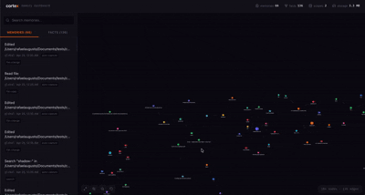

<h1 align="center">
  <br>
  <a href="https://github.com/rafaelaugustos/cortex-claude">
    
  </a>
  <br>
</h1>

<h4 align="center">Memory that remembers what matters. Built for <a href="https://claude.ai/claude-code" target="_blank">Claude Code</a> and Codex.</h4>

<p align="center">
  <a href="LICENSE">
    
  </a>
  <a href="pyproject.toml">
    
  </a>
  <a href="pyproject.toml">
    
  </a>
</p>

<p align="center">
  <a href="#quick-start">Quick Start</a> &bull;
  <a href="#how-it-works">How It Works</a> &bull;
  <a href="#tools">Tools</a> &bull;
  <a href="#web-dashboard">Dashboard</a> &bull;
  <a href="#configuration">Configuration</a> &bull;
  <a href="#benchmarks">Benchmarks</a> &bull;
  <a href="#development">Development</a>
</p>

<p align="center">
  Cortex gives Claude Code persistent memory through a local MCP server. Unlike solutions that dump everything into context, Cortex uses <strong>progressive recall</strong> &mdash; a 3-layer retrieval system that returns only what's relevant, using the minimum tokens needed.
</p>

<br>

<p align="center">
  
</p>

<p align="center"><em>Interactive knowledge graph &mdash; explore entities, facts, and memories visually.</em></p>

---

## The Problem

Memory solutions for AI assistants today waste tokens. They inject entire memory banks into every prompt, regardless of relevance. Cortex takes a different approach:

**Save once:**
> "The auth service uses JWT tokens with 24-hour expiry. Refresh tokens are stored in httpOnly cookies."

**Ask later, get back only what matters:**

```
Layer 1: Facts (cheapest)
  auth service → use → jwt tokens
  auth service → use → hour expiry

Layer 2: Summary (~25% of original)

Layer 3: Full content (only if needed)
```

Archive recall uses token-budget and confidence heuristics to decide how much context to return. Shared learning adds relevant, compact context before the user prompt is processed.

---

## Shared learning

Cortex keeps one shared `learning.db`, independent of legacy archive scopes. Three independent sessions consolidate a personal preference; transferable experiences also require two origins. Retrieval never counts as evidence. Explicit standing user instructions can apply immediately, while project facts remain tied to their origin.

- **Local semantic matching:** a resident multilingual model recognizes high-confidence paraphrases. Negation, opposing preferences, numbers, technical identifiers and task conditions prevent unsafe merges. Ambiguous matches stay separate. Hooks wait at most 250 ms for embeddings, then continue with lexical matching.
- **Verified experiences:** `cortex_learn action="experience"` stores a conclusion plus situation, cause and solution. A successful test receipt from the current session is required for reuse. Unverified episodes remain hypotheses; a failed application suspends reuse. The assistant must judge whether that test actually verifies the solution.
- **Conditions and validity:** `all`/`any`/`none` task cues express exceptions. Matching exceptions override generic preferences. Changes to explicitly tracked files, expiry (90 days by default for experiences) or failed verification require revalidation.
- **Progressive retrieval:** automatic context contains compact conclusions; `cortex_learn action="read"` fetches details only when needed. Defaults: up to 180 estimated tokens per prompt, reduced for short/weak matches, and 600 per session including details. Duplicate delivery is suppressed until compaction.
- **Observable results:** the dashboard shows provenance, verification commands, conditions, stale lessons, injected context, provider token counters from main-session transcripts, and matched task evaluations. It does not infer total savings from context deduplication.
- **Useful additions only:** acknowledgements and conclusions already supplied in the prompt are omitted. Explicit usefulness feedback adjusts ranking without creating evidence; repeated negative feedback can suppress irrelevant lessons for similar tasks.
- **Incremental reads:** `cortex_read` returns bounded lines, then verified diffs or an unchanged marker within the same session. A new/ambiguous session receives full content. Native editors that require their own Read receipt should use that Read directly before editing.
- **Task continuity:** `cortex_task` stores an objective, decisions, pending work and next step in at most 240 tokens. Checkpoints live in the shared database, are matched to their repository, expire after 14 days and are checked against file hashes. Revisions prevent stale updates.
- **Conflict review:** divergent conclusions stop automatic reuse. The dashboard lets you choose one or add conditions; ordinary repetition cannot silently override a conflict.

The prompt extractor recognizes direct EN/PT preferences, not arbitrary prose. The assistant already working on the task supplies nuanced observations and experiences; no extra LLM call runs per prompt. Legacy archives are preserved and never silently promoted into trusted preferences.

From a source checkout, update hooks, prepare the local model once, and restart Claude Code:

```bash
uv run cortex-claude setup --hooks-only
uv run cortex-claude learning prepare
uv run cortex-claude learning status
uv run cortex-claude learning context "Implement an endpoint"
uv run python scripts/evaluate_learning.py
uv run python scripts/evaluate_semantic.py --output /tmp/cortex-semantic.json
uv run python scripts/evaluate_tasks.py --output /tmp/cortex-tasks-offline.json
# Optional: uses your Claude account. Same model/tools and independent tests in both arms.
uv run python scripts/evaluate_tasks.py --live --repeats 2 --budget 0.40 --output /tmp/cortex-tasks.json
```

The local embedding model is downloaded once (roughly 470 MB) and runs in the daemon, offline. Basic lexical learning works without it. Context counters use `cl100k_base`; task evaluations use provider input/output/cache usage and independently grade the resulting code. Small samples are not guarantees of savings. The live evaluator uses temporary projects and synthetic, locally verified experience; it does not read your personal memories.

The checked-in [0.10.0 evaluation](docs/evaluations/0.10.0.json) contains 12 valid live runs (three per arm across two synthetic tasks), all passing the independent grader. Mean total tokens changed by **+7.58%** for environment flags and **−20.32%** for expiry handling. Both results are retained; these small samples do not establish general savings. The real multilingual daemon/hook check also passed, with roughly 90–110 ms per hook including process startup on the test machine.

The [0.11.0 evaluation](docs/evaluations/0.11.0.json) expands this to five tasks, including multifile changes, shared-helper refactoring and task resumption. It preserves 20 initial runs and 20 runs after correcting guidance that could duplicate native editor reads. All 40 passed their independent graders. In the final sample, mean token changes were **+6.66%** (flags), **−21.93%** (expiry), **−2.94%** (multifile money), **+0.58%** (refactoring) and **+1.73%** (resumption). The initial refactoring regression of +26.21% remains recorded. `--check-regression` exits nonzero for lost quality or a per-task increase above 25%; the final sample passes this gate, which is not a guarantee of savings.

## Recovery and Codex

Both clients use the same local `learning.db`. Project knowledge keeps its repository origin and source fingerprints. Hooks first persist minimized events to an atomic disk queue; retries preserve session ordering and acknowledge only after durable effects. SQLite writes use WAL and `synchronous=FULL`. No extra model call is needed for recovery.

```bash
cortex-claude setup --hooks-only
cortex-claude recovery install-codex
cortex-claude recovery install-services   # macOS: daemon and dashboard at user login
cortex-claude recovery status
cortex-claude recovery self-test          # isolated capture/save/reconnect/restore proof
cortex-claude recovery diagnose           # sample services and record state changes
cortex-claude recovery backup             # creates, verifies and tests restoration
cortex-claude recovery list
cortex-claude recovery verify SNAPSHOT_ID
cortex-claude recovery restore SNAPSHOT_ID --destination /absolute/new/recovered-directory
```

Restart Codex and review the Cortex commands using `/hooks`. [Codex requires explicit hook trust](https://learn.chatgpt.com/docs/hooks); setup preserves other MCP servers/hooks/instructions and never bypasses that review. MCP tools can connect before hooks are trusted, but automatic checkpoints require working hooks. The dashboard distinguishes configuration from received client events.

The **Saúde & recuperação** dashboard shows service availability, pending work, last durable knowledge/checkpoint write, connected clients and verified backups. It can retry pending operations, create a backup, test restoration and recover a separate copy. Automatic checkpoints retain a compact request, up to five changed paths and the last assistant report; that report is explicitly unverified. They complement the structured checkpoints saved by the assistant and do not reconstruct every detail of a conversation.

Backups default to every six hours and retain sixteen complete snapshots. Each includes online SQLite backups, configuration and pending operations, with SHA-256 checksums, database integrity checks and a restoration test. Models and login credentials are excluded. A failed backup preserves previous snapshots; a corrupt snapshot is rejected. Restoring always requires a new directory and leaves the active database untouched.

The dashboard reports storage failures explicitly instead of presenting partial archive results as complete. Health checks continue even when another dashboard request fails; a failed health refresh removes the previous availability indicator. Automatic checkpoint configuration and confirmed client events are shown separately.

The **Prova de memória entre sessões** action runs eight checks against disposable data: both clients' hook handlers, persistence, retrieval by a different process, context deduplication, MCP reconnection, and backup restoration. It does not activate client hooks or prove that an AI model followed the retrieved memory. Real capture, durable save and context-delivery timestamps appear separately for each client. The daemon samples health every minute and retains the last 100 incident/recovery transitions locally without prompts or tool output.

Project refresh now builds a bounded static map (up to 240 compatible source files and 2 MB of changed source per scan), including Vue script blocks. It caches symbols and call candidates, reuses unchanged files, discovers additions, removes deleted sources, and exposes coverage gaps. Changed source files disappear from the current map until refreshed; affected human/assistant conclusions enter a review queue and stay out of automatic context until explicitly revalidated. Static calls do not establish runtime behavior or business semantics.

The [0.14.0 evaluation](docs/evaluations/0.14.0.json) contains eight live runs across two tasks and two clients, all passing independent graders. Token changes were **−40.83% / +1.60% for Claude** and **+0.33% / +0.32% for Codex** (expiry / multifile money). These are single pairs, not evidence of universal savings. Codex evaluation uses explicit memory retrieval with personal hooks disabled; its deferred hook authorization remains untouched. Cached Codex input is counted once, and no Codex dollar cost is inferred. The adapter follows the [official non-interactive JSONL contract](https://learn.chatgpt.com/docs/non-interactive-mode).

```bash
uv run python scripts/evaluate_tasks.py --live --client codex --model YOUR_MODEL --case expiry-units-v1 --output /tmp/codex-evaluation.json
uv run python scripts/release.py build --output /tmp/cortex-release
uv run python scripts/release.py rollback --previous /path/to/0.13.0.whl --current /path/to/0.14.0.whl --output /tmp/rollback.json
```

Release verification rebuilds the dashboard and wheel twice, requires identical SHA-256 hashes, and checks bundled assets. Rollback verification installs both actual wheels in a disposable virtual environment and checks notes, checkpoints and SQLite integrity through old → new → old → new. The new code cache is additive and retains schema-5 compatibility with 0.13.0. This does not authorize downgrading to older schema versions. The CI release path publishes the exact verified wheel after Python and browser checks; local verification does not claim a remote CI run passed.

To use a restored directory, stop clients and the two Cortex services, preserve the existing directory, and configure both clients and services to use the recovered directory through `CORTEX_HOME` before starting them again. Do not copy SQLite files over a running service. The recovery directory contains the data and pending queue, not installed hooks, launch agents or cached models: rerun setup/client/service installation for that directory. Test it in isolation before switching production memory.

On macOS, launchd restarts a failed daemon/dashboard and starts them after user login. To stop automatic services, use `launchctl bootout gui/UID/com.cortexclaude.daemon` and the corresponding `.web` label (replace `UID` with `id -u`); retain the plists to re-enable with `launchctl bootstrap`. This does not promise operation before login or recovery of input that never reached a hook. A local backup does not protect against losing the computer or its disk; configure `reliability.mirror_directory` to an existing external/synchronized directory for a second copy. No system guarantees complete semantic recall or 100% availability.

## Key Features

- **Progressive recall** &mdash; 3 layers (facts &rarr; summaries &rarr; full content), stops at the cheapest sufficient layer
- **Code graph** &mdash; tree-sitter extracts symbols (functions, classes, calls, imports) from Python, JS, TS, Go, Java, Swift, Kotlin into the same knowledge graph. `cortex_code(symbol)` returns definition + callers + callees in ~100 tokens vs ~1000+ to read the file
- **Auto-clustering** &mdash; memories self-organize into semantic sub-graphs by embedding similarity. Labels derived from the most frequent entities. Navigate top-down via `cortex_clusters`
- **Smart capture filter** &mdash; heuristic gate (keywords, entity density, tool type) decides what to keep from auto-capture. Optional LLM-judge for ambiguous cases. No more polluting memory with `ls` and trivial reads.
- **Knowledge graph** &mdash; auto-extracts structured facts via spaCy NLP with multi-hop traversal
- **Smart extraction** &mdash; handles bullet lists, key:value pairs, comma lists, slash-separated tech, parentheticals, passive voice
- **Claude fallback** &mdash; optional Claude-assisted extraction when local NLP isn't enough
- **Entity normalization** &mdash; "postgres", "PostgreSQL", "pg" all resolve to the same entity
- **Graph traversal** &mdash; navigate entity connections across multiple hops (A &rarr; B &rarr; C)
- **Hybrid search** &mdash; vector similarity + FTS5 keyword search combined
- **Configurable scopes** &mdash; global, per-project, or custom memory boundaries
- **Deduplication** &mdash; detects and merges near-identical memories automatically
- **Fact merging** &mdash; when multiple memories mention the same fact, it's consolidated into one with boosted confidence
- **Temporal awareness** &mdash; facts detect when things happened ("in April 2024", "yesterday", "since v2") and attach timestamps
- **Confidence recalibration** &mdash; facts gain confidence when accessed frequently, lose it when contradicted by newer information
- **Decay system** &mdash; unused memories lose relevance over time, keeping results fresh
- **Auto-capture** &mdash; direct preferences and test receipts are captured by hooks; raw tool-result archival is opt-in
- **Task context injection** &mdash; supplies relevant learned conclusions before a prompt, with deduplication and a token budget
- **Background daemon** &mdash; pre-loaded model for instant saves via Unix socket (~0.3s vs ~5s cold start)
- **Multi-language** &mdash; EN, PT (auto-detected). ES, DE, FR with additional spaCy models
- **Embedding model choice** &mdash; 11 models supported, from fast (all-MiniLM, 384d) to high-quality (bge-large, 1024d). Auto-detects dimensions
- **Local-first** &mdash; SQLite + local embeddings + local NLP. No additional model API calls for local learning; initial model downloads need network access
- **Privacy tags** &mdash; wrap sensitive content in `<private>...</private>` to exclude it from memory
- **Fully configurable** &mdash; all thresholds, ratios, and behaviors via config.json

---

## Quick Start

### One-Command Install (recommended)

Cortex depends on spaCy and PyTorch, which don't have wheels for every Python version — installing with whatever `python3`/`pip` happens to be on your PATH is the most common source of install failures (cryptic compilation errors, version conflicts with other packages). [`uv`](https://docs.astral.sh/uv/) sidesteps this entirely: it downloads and manages an isolated, compatible Python interpreter for you, with zero manual version wrangling.

```bash
# Install uv if you don't have it yet (one-time, ~5s)
curl -LsSf https://astral.sh/uv/install.sh | sh

# Install cortex-claude — uv picks a compatible Python automatically,
# fully isolated from your system Python. No version conflicts.
uv tool install cortex-claude --python 3.12
cortex-claude setup
```

That's it. The setup command:
- Configures the MCP server globally for Claude Code
- Installs hooks (SessionStart, UserPromptSubmit, PostToolUse, PostToolUseFailure, Stop), preserving unrelated hooks
- Creates `~/.claude/CLAUDE.md` with instructions for Claude to use Cortex automatically
- Downloads archive embeddings (~80MB), multilingual learning embeddings (~470MB) and the spaCy model (~12MB)
- Starts the background daemon for instant saves
- Prints a clear pass/fail summary for every step, and is safe to re-run if anything failed (e.g. a model download blocked by a proxy/firewall)

Restart Claude Code and it works in **every project**, no per-project config needed. Relevant learned context arrives automatically; Claude can request more detail when needed.

### Upgrading

`uv tool install cortex-claude` is idempotent by design &mdash; if it's already installed, running it again is a no-op and does **not** fetch a newer version, even after you've `uv tool install`ed a fresh copy. Use the dedicated upgrade command instead:

```bash
uv tool upgrade cortex-claude
cortex-claude setup
```

(`pip install --upgrade cortex-claude` is the equivalent if you installed via pip.)

### Alternative: pip

```bash
pip install cortex-claude && cortex-claude setup
```

Requires Python 3.11&ndash;3.13 available as `pip`'s interpreter. If you hit install errors (common causes: a Python 3.14+ system interpreter, or a `pip` that resolves to a version without spaCy/PyTorch wheels), use the `uv tool install` method above instead &mdash; it manages the Python version for you.

### With Claude-assisted extraction (optional)

```bash
pip install cortex-claude[claude]
# or: uv tool install cortex-claude[claude] --python 3.12
```

### Manual Setup (alternative)

If you prefer manual configuration, add a `.mcp.json` to your project root, pointing `command` at wherever `cortex-claude` was installed (run `which cortex-claude` to find it):

```json
{
  "mcpServers": {
    "cortex": {
      "type": "stdio",
      "command": "cortex-claude",
      "args": []
    }
  }
}
```

### Use

Just talk to Claude naturally. Cortex works in the background:

```
"Remember that the API uses rate limiting at 500 req/min"
"What do you know about rate limiting?"
"What facts do you have about the API?"
"What's connected to the auth service?"
"Forget what I said about the old API key"
"Show me the memory status"
```

---

## Tools

Cortex exposes **11 MCP tools** to Claude Code:

| Tool | What it does | Token cost |
|------|-------------|------------|
| `cortex_learn` | Observe, correct, inspect or forget shared learning | Compact notes, up to 80 tokens |
| `cortex_read` | Bounded file inspection with session-local diffs | Default 800, hard limit 4,000 tokens |
| `cortex_task` | Save, resume and complete work checkpoints | Checkpoint fields up to 240 tokens |
| `cortex_save` | Store memory with auto fact extraction, summarization, and embedding | N/A |
| `cortex_recall` | Progressive retrieval: facts &rarr; summaries &rarr; full content | Controlled via `max_tokens` |
| `cortex_facts` | Direct knowledge graph query, returns structured triplets | ~5-15 tokens per fact |
| `cortex_traverse` | Navigate the knowledge graph; accepts `start="cluster:42"` to begin from a sub-graph | ~5-15 tokens per connection |
| `cortex_code` | Look up a code symbol: definition, callers, callees, mentions | ~50-150 tokens vs ~1000+ to read the file |
| `cortex_index_code` | Index a file or directory into the code graph (Python, JS/TS, Go, Java, Swift, Kotlin) | N/A |
| `cortex_clusters` | List or rebuild memory sub-graphs (auto-formed by similarity) | ~10 tokens per cluster |
| `cortex_forget` | Delete memories by query or ID (dry-run by default) | N/A |
| `cortex_scopes` | Manage scopes: list, create, delete, link/unlink directories | N/A |
| `cortex_status` | Dashboard: memory count, fact count, storage size per scope | N/A |

### Recall Depth Modes

| Mode | Returns | When to use |
|------|---------|------------|
| `auto` | Starts cheap, escalates if needed | Default &mdash; best for most queries |
| `facts` | Only knowledge graph triplets | Quick lookups, minimal token use |
| `summaries` | Facts + compressed summaries | Medium detail needed |
| `full` | All layers including original text | Full context needed |

---

## How It Works

```
Save: content → embedding + fact extraction + summarization → SQLite

Recall (progressive):
  1. Facts layer     (~5-15 tokens/fact)   → sufficient? stop
  2. Summaries layer (~25% of original)    → sufficient? stop
  3. Full chunks     (original content)    → return
```

### Fact Extraction

Three methods combined for maximum coverage:

1. **spaCy NLP** &mdash; dependency parsing, NER, passive voice handling, conjunction expansion
2. **Pattern matching** &mdash; bullet lists (`- X for Y`), key:value, comma lists, slash-separated (`React/TypeScript`), parentheticals (`FastAPI (Python)`), with/for constructs
3. **Claude fallback** (opt-in) &mdash; when local extraction produces < 2 high-confidence facts, falls back to Claude Haiku. Off by default.

Entities are normalized and deduplicated: `"postgres"` &rarr; `"postgresql"`, `"js"` &rarr; `"javascript"`, `"k8s"` &rarr; `"kubernetes"`.

### Graph Traversal

Navigate entity connections across multiple hops:

```
auth → JWT → express-jwt → middleware
  ↓
  httpOnly cookies
```

Query `cortex_traverse("auth")` and discover everything connected.

### Decay

Memories that aren't accessed lose relevance over time:

```
score = e^(-lambda * days) * (1 + log(access_count))
```

Recalculated on server startup. Frequently accessed memories get boosted. Stale ones fade.

### Auto-Capture &amp; Hooks

Cortex installs three hooks globally, preserving hooks from other tools:

- **SessionStart** registers the session and starts code indexing in the background. It does not inject unrelated facts or a repeated tool manual. After compaction it resets delivery receipts so relevant lessons can be supplied again.
- **UserPromptSubmit** observes direct user preferences and retrieves learned context before Claude answers. The same session cannot confirm a lesson twice, and already-delivered notes are omitted.
- **PostToolUse** maintains the code graph for Read/Edit/Write. Raw tool-result capture is **off by default**; `learning.capture_tools` only enables other eligible tool results. Bash, file operations and internal task transcripts are always excluded. Tool output never confirms a personal preference.

`<private>` content is removed before clipping. The previous command-rewriting PreToolUse hook is removed on upgrade. The daemon handles the optional code graph and archive operations; learned context uses a lightweight local SQLite path without loading PyTorch or spaCy.

### Code Graph

Tree-sitter parses your source files into structured facts in the same knowledge graph used for memories:

```
my_func   → defined_in  → /path/to/file.py:42
my_func   → in_language → python
my_func   → calls       → other_func
MyClass   → extends     → BaseClass
sample    → imports     → json
```

Trigger manually with `cortex_index_code(path)` for a directory, or let auto-capture index files as you read/edit them. Look up symbols with `cortex_code(symbol)` &mdash; returns definition, callers, callees, extends, imports, and which memories mention it. **Supported languages:** Python, JavaScript, TypeScript/TSX, Go, Java, Swift, Kotlin.

When a saved memory mentions a known symbol, Cortex automatically creates a `memory:<id> → mentions → <symbol>` fact, linking decisions and bug reports to the code they reference.

### Memory Clusters (Sub-graphs)

As memories accumulate, Cortex groups them into semantic clusters using cosine similarity on their embeddings. Each cluster gets a human-readable label derived from the most frequent entities in its facts (e.g. `"embeddings, vectors, sqlite-vec"`).

```bash
# List clusters
cortex_clusters

# Traverse the graph starting from a cluster
cortex_traverse start="cluster:42"

# Rebuild clusters after tuning similarity_threshold
cortex_clusters action="backfill"
```

Clustering runs incrementally in the background after every N saves (default 20, with a 5-minute cooldown). The default `similarity_threshold=0.70` balances cluster coherence with singleton noise &mdash; tune it in `config.json` if your corpus needs tighter or looser grouping.

### Privacy

Wrap sensitive content in `<private>` tags to exclude it from memory:

```
The API uses JWT for auth. <private>API_KEY=sk-abc123secret</private> Tokens expire in 24h.
```

Cortex strips everything between `<private>...</private>` before saving. Works in both manual saves and auto-capture. If the entire content is private, nothing is saved.

### Hybrid Search

Combines **vector similarity** (semantic meaning) with **FTS5** (exact keyword match) for best recall. FTS5 synced automatically via SQLite triggers.

### Web Dashboard

Browse, explore and prune your memory:

```bash
cortex-claude web
# Opens at http://localhost:37800
```

The web dashboard uses Vue 3 and [Mavis Web](https://mavis-ui.getcortexlabs.com/), with light/dark themes and responsive navigation. The graph remains bounded and loads only when needed.

Features:
- **Overview and learning** &mdash; active lessons, provenance, usefulness feedback, review state and deletion.
- **Task handoffs** &mdash; inspect decisions and next steps, mark complete or forget, with stale-file warnings.
- **Conflict review** &mdash; compare evidence, select a conclusion or give it specific conditions.
- **Economy and quality** &mdash; provider-measured task comparisons, local duplicate-read estimates and omission reasons; increases in consumption stay visible.
- **Connections** &mdash; open a topic to see its sub-graph and related memories, with a keyboard-accessible entity picker.
- **Entity focus** &mdash; click a node for that entity's neighbourhood, its facts, and the memories that mention it.
- **Memory browser** &mdash; search, filter by scope and tag, sort by recency, relevance, last use or size. Paginated server-side.
- **Bulk cleanup** &mdash; select by tag, scope, cluster or regex and preview exactly what goes before anything is deleted. Removing a memory takes its facts and its vector with it.
- **Live stats** &mdash; memory and learning counters refresh while the page is visible. Browser tests exercise the real local API against disposable data.

The dashboard binds to localhost only, sends no CORS headers, and validates
`Host` and `Origin` so no other page in your browser can read or modify your
memory.

---

## Cortex vs Traditional Memory (claude-mem, etc.)

Most memory solutions for AI assistants follow the same pattern: capture observations, compress them, inject into every prompt. Cortex takes a fundamentally different approach.

| | Traditional (claude-mem) | Cortex |
|---|---|---|
| **Storage model** | Compressed text / summaries | Knowledge graph (structured triplets) + summaries + full text |
| **Retrieval** | Auto-inject into every session (~500-2000 tokens) | Progressive recall: facts &rarr; summaries &rarr; full (~50-100 tokens) |
| **Intelligence** | Linear summaries | Structured facts with entity relationships + graph traversal |
| **Search** | Keyword / vector | Hybrid: semantic embedding + FTS5 keyword + graph traversal |
| **Extraction** | Captures tool call observations | NLP fact extraction (spaCy + patterns + optional Claude) |
| **Entity awareness** | None | "postgres" = "postgresql" = "pg" (normalized + fuzzy match) |
| **Graph navigation** | None | Multi-hop traversal (A &rarr; B &rarr; C) |
| **Staleness** | No decay | Unused memories lose relevance over time |
| **Duplicates** | Can accumulate | Auto-merged (cosine similarity > 0.92) |
| **Auto-capture** | All tool calls via hooks | All tools (Bash, Read, Edit, Write, Grep, Glob, Agent, MCP, Web) via hooks + daemon |
| **Session injection** | Full context dump on start | Lightweight facts injection via direct SQLite (<1s) |
| **Dependencies** | Node.js, Bun, Chroma vector DB | Python + SQLite only (zero external services) |
| **Web UI** | Viewer on localhost:37777 | Interactive graph dashboard on localhost:37800 |

### Where Cortex wins

- **Token efficiency** &mdash; bounded learned context with repeated delivery suppressed; archive recall offers facts, summaries and full content.
- **Structured understanding** &mdash; knowledge graph with traversal vs flat text. Ask "what's connected to auth?" and get real graph navigation.
- **Entity intelligence** &mdash; normalizes and deduplicates entities across memories. "postgres", "PostgreSQL", and "pg" are the same thing.
- **Freshness** &mdash; decay system ensures frequently accessed memories rank higher. Old, unused memories fade.
- **Zero external services** &mdash; no Chroma, no Bun, no Node.js. Just Python + SQLite.
- **Multi-language** &mdash; fact extraction works in EN, PT (auto-detected), with ES/DE/FR support.

### Where claude-mem wins

- **Broader auto-capture** &mdash; captures all tool calls including MCP tools from third-party servers.
- **Web viewer** &mdash; real-time memory browser (Cortex has an interactive graph dashboard, but claude-mem's is more mature).
- **One-command install** &mdash; `npx claude-mem install` vs manual MCP config.
- **Larger community** &mdash; more stars, Discord, extensive documentation site.

### The fundamental difference

Traditional memory asks *"what happened?"* &mdash; Cortex asks *"what matters?"*

Traditional solutions observe and replay. Cortex understands, structures, and retrieves surgically. The result: fewer tokens, more relevant answers, and a knowledge graph that grows smarter over time.

---

## Benchmarks

Historical archive microbenchmark with 10 stored memories (244 total tokens), separate from the shared-learning evaluation:

| Depth | Tokens returned | Reduction | Latency |
|-------|----------------|-----------|---------|
| `facts` | 82 | **66%** | ~10ms |
| `auto` | 82 | **66%** | ~10ms |
| `full` | 244 | 0% | ~12ms |

| Operation | Latency |
|-----------|---------|
| `cortex_facts` query | **0.1ms** |
| Graph traversal (2 hops) | **0.2ms** |
| Save (after model load) | **~30ms** |

Run benchmarks yourself:

```bash
uv run python scripts/benchmark.py
```

### How Token Counts Work

The percentages and token counts above are **estimates, not exact Claude token counts**. Cortex has no access to Claude's real tokenizer (it isn't publicly available outside Anthropic's API), so `count_tokens()` uses OpenAI's `tiktoken` (`cl100k_base` encoding) as a stand-in. It's close enough to drive internal budgeting decisions (recall depth, `max_tokens` cutoffs, dedup thresholds), but the absolute numbers can differ from what Claude itself would count — treat them as **directionally correct, not exact**.

The benchmarks above were also measured against a small corpus (10 memories). Some operations that report sub-millisecond latency here (e.g. `cortex_facts`) rely on non-indexed `LIKE '%word%'` scans internally and will not stay sub-millisecond as the fact table grows into the tens of thousands of rows — see the note on fact search in `core/engine.py` for where that fallback is used.

---

## Configuration

All behavior is customizable via `~/.cortex-claude/config.json`:

```json
{
  "recall": {
    "default_max_tokens": 200,
    "default_depth": "auto",
    "sufficiency": {
      "coverage_threshold": 0.7,
      "confidence_threshold": 0.6
    }
  },
  "embeddings": {
    "model": "all-MiniLM-L6-v2",
    "batch_size": 32,
    "_available_models": [
      "all-MiniLM-L6-v2 (384d, 80MB, fast)",
      "all-mpnet-base-v2 (768d, 420MB, medium)",
      "BAAI/bge-small-en-v1.5 (384d, 130MB, fast)",
      "BAAI/bge-base-en-v1.5 (768d, 440MB, medium)",
      "BAAI/bge-large-en-v1.5 (1024d, 1.3GB, best quality)",
      "intfloat/e5-large-v2 (1024d, 1.3GB, best quality)",
      "intfloat/multilingual-e5-small (384d, 470MB, multilingual)"
    ]
  },
  "facts": {
    "extraction_method": "local",
    "min_confidence": 0.5,
    "claude_fallback": false,
    "claude_confidence_threshold": 0.5
  },
  "decay": {
    "lambda": 0.05,
    "recalculate_interval_hours": 6,
    "min_score": 0.01
  },
  "deduplication": {
    "similarity_threshold": 0.92,
    "merge_strategy": "append"
  },
  "scopes": {
    "mappings": {
      "/path/to/project-a": "project:a",
      "/path/to/project-b": "project:b"
    },
    "default": "global",
    "search_order": "project_first"
  },
  "storage": {
    "max_db_size_mb": 500
  }
}
```

All fields are optional. Defaults are used for anything not specified.

See [`examples/`](examples/) for ready-to-use configuration files.

---

## Development

```bash
git clone https://github.com/rafaelaugustos/cortex-claude.git
cd cortex-claude
uv venv --python python3.13
uv sync --all-extras
uv run python -m spacy download en_core_web_sm
uv run pytest
```

```bash
# Run the demo
uv run python scripts/demo.py

# Run benchmarks
uv run python scripts/benchmark.py
```

See [CONTRIBUTING.md](CONTRIBUTING.md) for contribution guidelines.

## Architecture

See [ARCHITECTURE.md](ARCHITECTURE.md) for the full technical specification.

---

## Something Missing?

We'd love to hear from you. Open an issue on GitHub:

**Found a bug?**
1. Go to [Issues](https://github.com/rafaelaugustos/cortex-claude/issues/new?template=bug_report.md&labels=bug)
2. Describe what happened vs. what you expected
3. Include your Python version, OS, and steps to reproduce

**Have a feature request?**
1. Go to [Issues](https://github.com/rafaelaugustos/cortex-claude/issues/new?template=feature_request.md&labels=enhancement)
2. Describe the problem you're trying to solve
3. Suggest a solution if you have one

**Want to contribute?**
1. Check [CONTRIBUTING.md](CONTRIBUTING.md) for guidelines
2. Look for issues labeled [`good first issue`](https://github.com/rafaelaugustos/cortex-claude/issues?q=is%3Aissue+is%3Aopen+label%3A%22good+first+issue%22)
3. Fork, branch, code, test, PR

---

## License

MIT &mdash; see [LICENSE](LICENSE).

---

<p align="center">
  <strong>Built with Python</strong> &bull; <strong>Powered by Claude Code</strong> &bull; <strong>Made by <a href="https://github.com/rafaelaugustos">Rafael Augusto</a></strong>
</p>

### Project knowledge, without execution noise

`cortex_project` reads bounded manifests and documentation headings, identifies modules, declared technologies and development commands, and stores them in the shared `learning.db`, keyed by repository path. SessionStart refreshes this structure in the background; `learning.project_memory: false` disables it. No package script is executed.

The assistant reads relevant docs/source files and uses `cortex_project(action="note", section="architecture", content="…", sources=["src/app.py"])` to save concise conclusions about purpose, architecture, conventions and decisions. Each conclusion keeps source fingerprints. Changed sources suspend automatic reuse until the assistant reviews and records the conclusion again; refreshing manifests alone does not validate notes. `read` returns bounded details (800 estimated tokens by default, up to 2,000). Automatic project context shares the existing message/session budget and is delivered once per project revision per session, after higher-priority memories.

The Mavis dashboard's **Projetos** page shows structured knowledge and its sources. Archive schema v9 moves previously auto-captured execution transcripts, their facts and vectors into recoverable history tables. **Histórico de execução** provides read-only access; these records no longer participate in recall, graph connections or memory clusters. Curated instructions such as how to run tests remain valid memories. Existing raw logs are preserved, not converted into unsupported conclusions.
